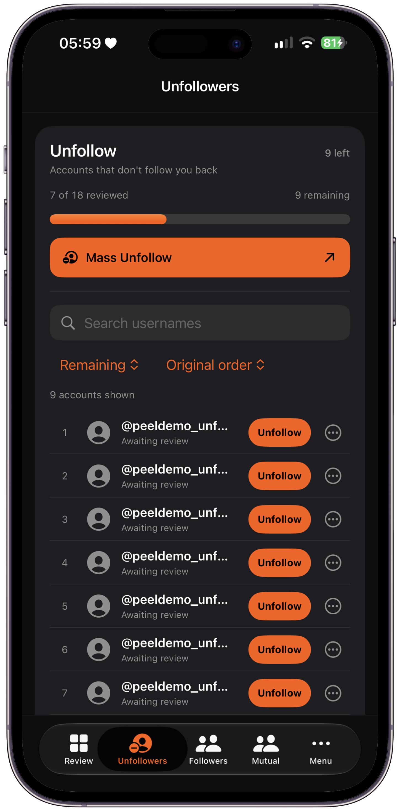
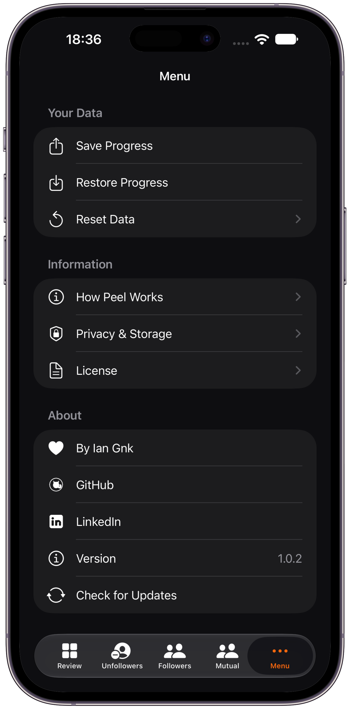

  

# Peel

A free & open-source iOS & iPadOS application for reviewing Instagram follower relationships, built in SwiftUI.

Peel compares follower and following lists from Instagram data exports, helping users manually review their connections while keeping their review progress on-device.

## Interface

  
  
  

  
  

  

## An Honest Project reflection

As an aspiring software engineer, I welcome opportunities to challenge my current abilities through independent technical assessments, constructive feedback and practical learning. I am prepared to be evaluated on my own knowledge, reasoning and problem-solving skills rather than solely on the capabilities of this application.

My ambition is not simply to produce working software, but to become an engineer who understands, takes responsibility for and can confidently maintain what they build.

Peel is a personal exploration of native iOS development, driven by my interest in building software that solves everyday problems.

The project was developed with assisted coding, which contributed to its implementation, architecture, testing and documentation. My contributions focused on product requirements, interface decisions, manual testing and troubleshooting, while maintaining all the feedback to properly guide and produce the expected results.

## Why Peel?

Many follower-management tools rely on automated account actions, unofficial integrations or external services that process personal relationship data.

Peel takes a different approach: local data analysis combined with guided manual review.

| Capability | Peel | Automation-based tools |
|---|---|---|
| Relationship analysis | Imported Instagram exports | May retrieve account data directly |
| Follow and unfollow actions | Performed manually | May execute automatically |
| Relationship data processing | On-device | May involve remote servers |
| Background account actions | None | May execute without user interaction |
| Password collection | No native password-entry form | Depends on implementation |
| User control | Individual account decisions | May support automated bulk actions |

### A lower-risk approach

Peel deliberately avoids automated following and unfollowing, background account actions and private account-action APIs.

Its guided review workflow opens individual Instagram profiles and allows users to decide whether to take action themselves.

By avoiding automated account actions, Peel reduces exposure to risks specifically associated with automation-based follower-management tools, including automated activity detection and account restrictions.

The application also avoids requiring users to upload their complete relationship graph to a dedicated tracking backend.

These design choices reduce specific risks but do not guarantee protection against account restrictions or suspension. Instagram may still apply activity limits, security challenges or other enforcement measures.

Users remain responsible for their account activity.

## Features

- Instagram data export import.
- Follower and following relationship comparison.
- Mutual and non-mutual relationship lists.
- Search, sorting, filtering and exclusions. Excluded accounts are skipped in all three review tabs and remain accessible through the All and Excluded filters.
- Guided manual profile review.
- Persistent review progress.
- Private profile-photo caching, with storage size and confirmed clearing in Menu → Reset Data.
- JSON backup and restoration.
- Isolated Demo Mode with sample data.
- Native iPhone and iPad layouts.

The **Mass Unfollow** feature is a guided manual review workflow, not an automated unfollowing mechanism.

## Installation

### Download Peel

Download the latest IPA

  

Computer Installation (Easiest)

  
  

Don't have a computer?

  

### Requirements

- iPhone or iPad.
- iOS/iPadOS 17.0 or later as the application's deployment target.
- A compatible signing and installation method.
- Access to the release IPA.

### AltStore Classic

1. Download the Peel IPA.
2. Install AltStore Classic and configure AltServer using the official instructions.
3. Transfer the IPA to your device.
4. Open AltStore and navigate to **My Apps**.
5. Tap **+** and select the Peel IPA.
6. Complete signing and installation.

Use AltStore Classic rather than AltStore PAL for individual IPA installation.

[AltStore website](https://altstore.io/)

### Sideloadly

1. Install Sideloadly on macOS or Windows.
2. Download the Peel IPA.
3. Connect your iPhone or iPad to your computer.
4. Open Sideloadly and select your device.
5. Load the IPA and configure signing.
6. Start the installation.
7. Complete any required developer trust or Developer Mode setup.

[Sideloadly website](https://sideloadly.io/)

### SideInstaller

1. Follow the official SideInstaller setup instructions for your iOS version.
2. Download the Peel IPA and save it to Files.
3. Open SideInstaller.
4. Select its custom IPA installation option.
5. Choose the downloaded IPA and complete installation.

[SideInstaller website](https://sideinstaller.net/)

### Installation limitations

- Free Apple Account signing typically requires renewal every seven days.

## Getting started with Xcode

The simulator is the recommended environment for technical evaluation.

1. Clone or download the repository.
2. Open `Peel.xcodeproj` in Xcode.
3. Select the shared **Peel** scheme.
4. Choose an iPhone or iPad simulator.
5. Press **⌘R** to build and run.

No third-party package installation, API keys or backend configuration is required.

## Try Demo Mode

For initial evaluation, use Demo Mode rather than personal Instagram data.

No Instagram account or personal data export is required.

1. Open Peel.
2. Hold the Peel logo for five seconds.
3. Navigate to **Menu → Your Data**.
4. Select **Import Sample Archive**.
5. Explore the sample relationships and review functionality.

The bundled archive contains 50 sample accounts with fictional relationships and timestamps:

- 15 mutual connections.
- 20 accounts that do not follow back.
- 15 followers you do not follow back.

Demo Mode is designed to keep sample data separate from personal review data.

Sample accounts load profile photos using the same Instagram profile-photo requests as other accounts. Photos require internet access; if unavailable, Peel shows its standard placeholder. Importing the bundled sample archive itself does not require network access.

Select **Exit Demo** to return to the normal application. After importing the sample archive, choose **Keep Sample Lists** to retain the sample relationships and Demo Mode review progress in an empty normal workspace. **Cancel** keeps Demo Mode active; **Exit Without Sample Lists** leaves personal data unchanged.

Peel never replaces existing personal lists or progress with sample data. To use sample lists in the normal workspace, first save a backup and reset your personal lists, then import the sample archive in Demo Mode and keep it when exiting.

Outside Demo Mode, confirm your own Instagram login to browse the sample accounts and use the normal manual review workflow. Live browsing and profile photos require network access. Sample relationships remain fictional and do not describe your Instagram account.

## Technologies

- Swift
- SwiftUI
- WebKit
- UIKit
- URLSession
- UserDefaults and Codable
- Compression and ImageIO
- Swift Testing and XCTest

The application does not require a dedicated backend or external package dependencies.

## Testing and verification

The repository includes automated tests covering archive parsing, relationship comparison, persistence, failure handling and user interface behaviour.

Recorded test results, reproduction instructions and known limitations are available in the [testing documentation](Docs/Testing.md).

Simulator testing does not establish complete physical-device compatibility, live Instagram compatibility or production readiness.

## Privacy

Peel follows a local-first approach to relationship analysis and review progress.

- Imported relationship data is processed on-device.
- No dedicated follower-tracking backend is required.
- No Peel account is required.
- Instagram login takes place on Instagram's website through WebKit.
- Peel does not provide a native password-entry form.
- Live website browsing and profile previews may communicate with external services.
- Exported backups contain usernames and review decisions and should be treated as private information.

Local processing does not mean the entire application operates offline. Website browsing and profile previews require network access.

## Documentation

- [Testing and verification](Docs/Testing.md)
- [Instagram integration](Docs/Instagram-Dependencies.md)
- [Release readiness](Docs/Release-Readiness.md)

## License

[MIT License](LICENSE)

[GitHub](https://github.com/gnkian) · [LinkedIn](https://www.linkedin.com/in/ioannisgnk)
