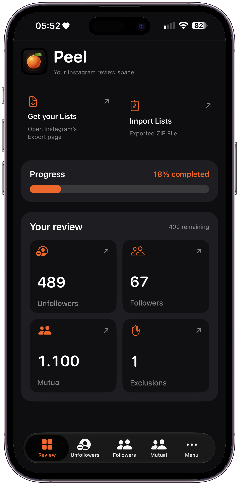
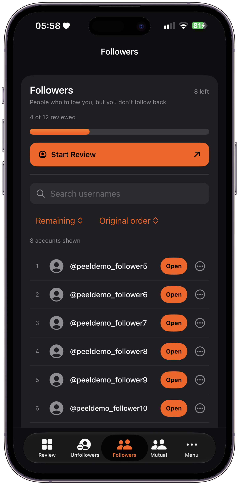
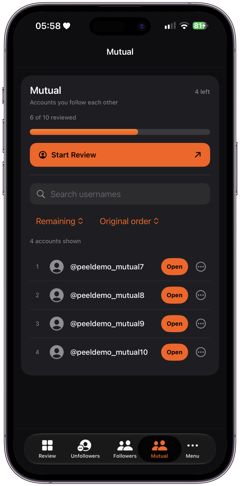
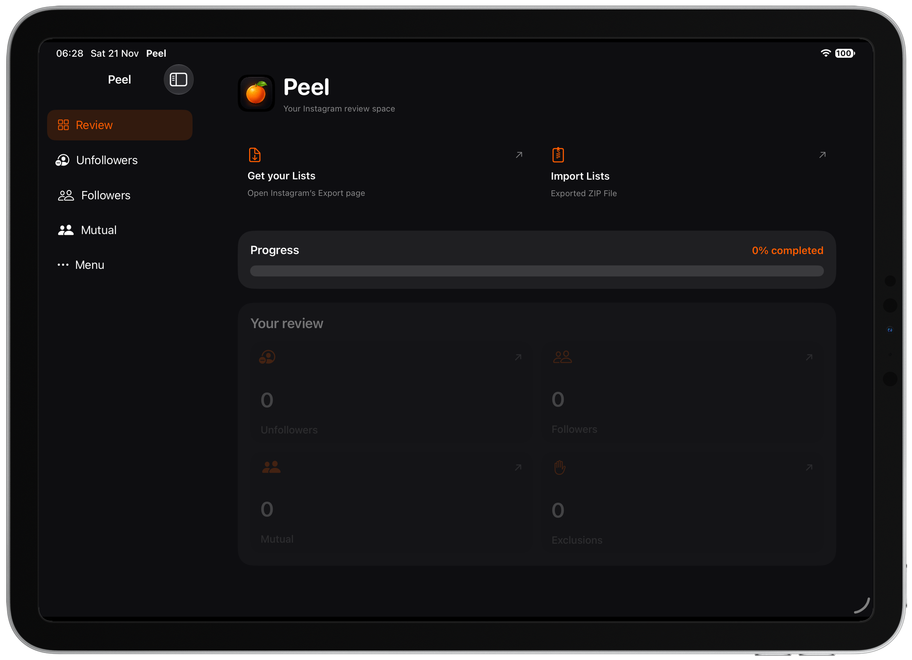
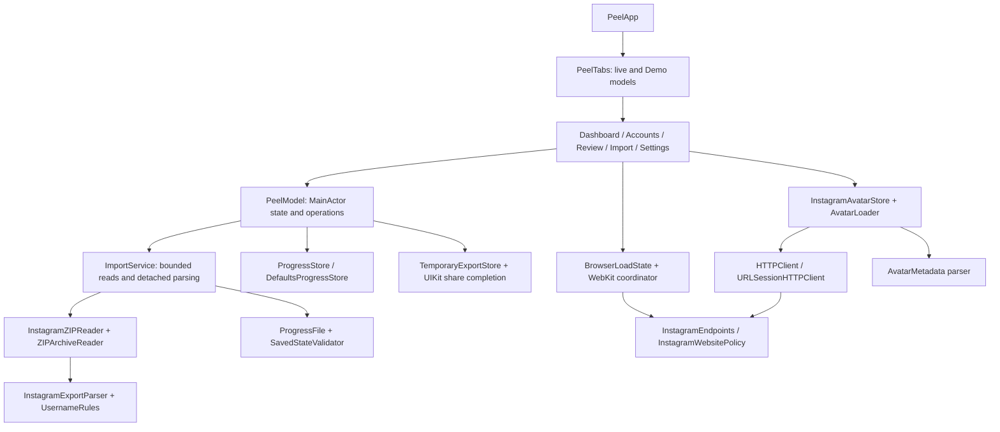

<p align="center">
  
</p>

# Peel

**Instagram export analysis and guided manual review, built with SwiftUI for iPhone and iPad.**

Peel compares the follower and following lists in an Instagram export, separates relationships into useful review queues, and remembers review progress. It is intended for people who want to work through their connections deliberately, without uploading their relationship graph to a follower-tracking backend.

**“Mass Unfollow” is a guided review flow, not automation.** Peel opens profiles on Instagram’s website. You perform any follow, unfollow or other account action yourself on that website. A review mark records a review, not proof that an account was unfollowed.

[Try the demo](#getting-started) · [Architecture](#architecture-and-data-flow) · [Tests](#testing-and-verification) · [Privacy](#privacy-and-security-boundaries) · [Documentation](#documentation)

## Interface

<p align="center">
  
  
  
</p>

<p align="center">
  
  
</p>

<p align="center">
  
</p>

These are existing app captures, not generated mockups. The iPhone lists show fictional Demo usernames; the supplied dashboard shows aggregate counts without an account identifier. These supplied captures predate the latest verification, and menu content may differ. The iPad image is an **earlier empty-state capture**: its dimmed informational card predates the later accessibility correction and is not evidence of current disabled-state styling. [Asset provenance](Docs/assets/README.md) records the sources and omissions. The gallery does not replace simulator or physical-device verification.

## Getting started

### Simulator first; no Instagram account required

1. Open `Peel.xcodeproj` and select the shared **Peel** scheme.
2. Choose an installed **iPhone or iPad simulator** and run with **⌘R**.
3. On Review, hold the Peel logo for **5 seconds** to enter Demo Mode. With VoiceOver, activate the logo or use its **Toggle Demo Mode** action.
4. In **Menu → Your Data**, tap **Import Sample Archive**. This Demo-only option imports the bundled synthetic ZIP through the production archive parser without a file picker or network access. It contains 50 technology-company usernames: 15 mutual, 20 not following back and 15 followers you do not follow back. All relationships and Unix timestamps are fictional.
5. Explore the imported lists, review counts, search, sorting, filters and exclusions. Demo Mode suppresses live profile browsing, avatar requests, personal-file imports, restoration and persistent review writes. Sample imports reset demo review progress and never overwrite real saved data.
6. Use **Exit Demo** to return to the live model and its saved data.

No backend account, API token, environment file or third-party dependency installation is needed. An earlier run missed activation of the former ten-second gesture; its cause remains unresolved despite later passes. Activation now uses a five-second hold.

### Verified toolchain and configuration

- **Xcode 27.2 (27B52)**; Swift **5 language mode**.
- Recorded simulators: **iPhone 17** and **iPad Air 11-inch (M4)**, both **iOS 27.2**.
- Deployment target: **iOS/iPadOS 17.0**. This is not a verified minimum Xcode version or evidence of physical iOS 17 execution.
- Debug: optimization **`-Onone`**, testability **`YES`**. Release: **`-O`**, testability **`NO`**.

The simulator is the simplest review environment. Physical-device builds require a suitable local Apple development-signing setup. The supplied app identifier is `org.iangnk.peel`; signing private keys and provisioning profiles are not included. Keep any local signing adaptation separate from evaluation of the supplied configuration.

### Live-data workflow

1. Sign in through Instagram’s website in Peel and manually confirm completion. Peel cannot verify that the session is authenticated.
2. Use **Get your Lists** for Instagram export instructions and the Accounts Center website.
3. Request and download **Followers and following**, then import the supported ZIP through **Import Lists**.
4. Inspect the dashboard and **Unfollowers**, **Followers** and **Mutual** lists.
5. Use **Mass Unfollow** or **Start Review** to visit profiles, or the individual list controls. Previous/Next retain browser history; successful intended-profile loading can mark that account reviewed.
6. Use **Menu → Save Progress** for a JSON backup, and **Restore Progress** to restore a supported backup. Backups contain usernames and review decisions; keep them private.

Instagram controls export availability, website challenges and HTML. Live login, 2FA and service compatibility require separate authorized manual verification.

## Implemented functionality

- **Relationship comparison:** accounts you follow that do not follow back, followers you do not follow back, and mutual connections. The **Followers** screen shows the second group, not the complete imported follower list.
- **Guided manual review:** embedded WebKit browsing, Next/Previous navigation, reviewed-state tracking and resumable progress. No automated Instagram account actions.
- **Queue controls:** username search, original/A–Z/Z–A ordering, Remaining/All/Reviewed/Excluded filters, individual exclusions and the existing start-from-account queue-trimming confirmation.
- **Consistent exclusions:** excluded accounts are skipped by the Unfollowers/Mass Unfollow queue. Followers and Mutual review still include them. Exclusion does not remove accounts from imported data.
- **Live dashboard counts:** comparison totals, remaining work, progress and exclusions derive from shared model state.
- **Import and recovery:** supported ZIP import, validated backup restore, startup restoration, reset confirmation, actionable failures, retry, file reselection and cancellation where applicable.
- **Profile previews:** best-effort public metadata/image loading, placeholders and Retry Photo. Missing avatars do not prevent list review.
- **Isolated Demo Mode:** a separate fictional model retained alongside the live model, with no live profile requests or persistent review changes.
- **Session controls:** Instagram website login, explicit manual confirmation and removal of selected WebKit website-data records on logout.
- **Native presentation:** compact-width tabs, regular-width sidebar, system file selection/sharing, English String Catalogs, Dynamic Type adaptations and VoiceOver actions.

## Architecture and data flow

Peel has one application target organized by feature and responsibility. These directories are not independently compiled modules. It is an incremental extraction of a working prototype: `PeelModel` remains a shared application model with view-model responsibilities, rather than a separate view model for every screen.



### State ownership and dependency injection

`PeelTabs` owns live and Demo `PeelModel` instances with `@StateObject`, injects the active model through `environmentObject`, and retains selection as view-local state. Screens observe that model; search, picker and presentation state remain local. The implementation uses `ObservableObject`/`@Published`, not an Observation-framework migration.

`PeelModel` is `@MainActor` and owns imported lists, review sets, exclusions, operation state and browser history. Its initializer accepts focused dependencies: `ImportServicing`, `ProgressStore`, `InstagramSessionServicing`, temporary-export ownership and an export-write closure. `HTTPClient` isolates avatar transport. These seams support failure/race tests without a backend or a general-purpose dependency container. Pure parsers use concrete types rather than additional protocols.

### Import and comparison

`ImportService` holds security-scoped access for bounded file reading, then composes:

1. `InstagramZIPReader`: selects recognized Instagram list filenames.
2. `ZIPArchiveReader`: validates structure, local/central filename agreement, compression, declared sizes and CRC. Selected content is decoded **in memory**, without extracting archive paths to the filesystem.
3. `InstagramExportParser`: handles existing JSON/HTML export structures. The service also retains standalone JSON/HTML/text list support; ZIP is the normal UI import workflow. Archive filename recognition is intentionally stricter than standalone type detection.
4. `UsernameRules`: validates, normalizes and deduplicates by first occurrence, retaining order.
5. `PeelModel`: validates a complete candidate snapshot before saving and applying it.

Comparison uses sets for membership while filtering ordered username arrays. Import retains compatible reviewed marks for accounts still in the queue. Counts, Remaining filters and browser selection follow the same exclusion rule. A recognized empty export is distinct from malformed or unrecognized input.

Live website rules and offline schemas have separate owners. [Instagram dependency ownership](Docs/Instagram-Dependencies.md) identifies where endpoint, metadata or export changes belong and which characterization tests should accompany them. `InstagramEndpoints` and `UsernameParser` retain compatibility entry points. Avatar metadata URL acceptance deliberately remains separate from HTTP transport validation.

### Persistence, backup and file ownership

`DefaultsProgressStore` encodes a coherent `SavedSnapshot` checkpoint and legacy queue/preferences values before changing saved values. The checkpoint is authoritative when present; legacy keys remain readable. `SavedStateValidator` checks decoded state. Corrupt startup data blocks normal writes instead of silently replacing saved bytes with empty defaults.

Model mutations save a validated candidate before applying it. Failed saves restore the last committed in-memory snapshot and retain a candidate for retry. Failed/canceled imports and stale completions cannot replace newer/reset state. **UserDefaults has no durable-write acknowledgment**: these protections do not guarantee survival of every storage or power-loss failure. Peel does not encrypt the stored data; it may participate in OS backups.

The JSON backup marker remains `follow-manager-backup-v1`, with existing fields and optional compatibility behavior. Restore decodes `ProgressFile` and validates it separately from Instagram parsing. Backup file writes are atomic.

`TemporaryExportStore` registers only files it created under Peel-owned temporary storage in the current process. Consumer tokens retain an export until UIKit reports share completion; unshared files and failed writes have separate cleanup paths. The store never sweeps imported archives, user-selected documents or all temporary files. View disappearance alone does not release a consumer. Unconfirmed prior-process exports are intentionally retained because a share extension may outlive Peel. Real extension lifetime/completion behavior remains a manual verification requirement.

## Concurrency and failure handling

- Model, persistence access, WebKit coordination and observable avatar state are main-actor isolated.
- Import parsing uses an explicitly detached worker with cancellation propagation. Bounded reads/parsing/decompression check cancellation; the caller checks again before using a result.
- Operation and browser request generations reject late results after reset, replacement, dismissal or navigation changes. Cancellation is not presented as a user-facing operation failure.
- `BrowserLoadState` models loading, success and failure. Teardown stops loading and clears delegates/callbacks; a failed or wrong-profile page is not a successful review.
- `AvatarRequestGate` is an actor limiting concurrent avatar operations to four. The store shares in-flight tasks per username, propagates cancellation and observes retry dates/cooldowns. It is not an account-action scheduler.
- `PeelError`, `OperationFailure` and `OperationState` carry explicit failures and presentation state. Alerts and browser overlays offer retry, cancellation or selecting another file as appropriate. Rate-limited retries respect the recorded retry date.

Failure paths cover offline/network errors, invalid URLs, HTTP errors/429 responses, missing or changed metadata, image decoding, malformed ZIP/JSON, unsupported formats, invalid backups, corrupt saved data, failed writes and WebKit process termination. A retry path cannot promise recovery from an unavailable or changed external service.

## Privacy and security boundaries

Comparison and review state stay on-device rather than requiring a Peel-operated tracking backend. This reduces the need to disclose a relationship graph to another service. It is a design choice, not a claim that Peel is safer than every alternative.

- No Peel account, analytics SDK, Firebase, Supabase, remote storage or third-party package dependency is present.
- Login occurs on Instagram’s website inside persistent `WKWebView` storage. Peel has no native password-entry form. WebKit may retain cookies/sessions; the local confirmation Boolean is not authentication evidence.
- Logout removes website-data records matching the integration’s Instagram/Facebook/CDN selection. This is not proof of server-side revocation or removal of every external session.
- Avatars use a separate ephemeral, cookie-disabled `URLSession`. The transport checks initial, redirected and final URLs against an HTTPS host predicate. This restriction does **not** make WebKit navigation an equivalent allowlist.
- Avatar page/image responses are bounded at 1 MB/3 MB. The loader retains its two-request sequence and metadata precedence, without private APIs or fallback scraping methods.
- ZIP limits are 100 MiB per archive, 16 MiB per selected file and 40 MiB total decoded selected content. Bounds and CRC validation address specific risks, not every possible malformed-input attack.
- Backups contain usernames and review decisions. Sharing providers and OS backups can take data off-device; Reset Lists cannot remove previously shared copies.
- `PrivacyInfo.xcprivacy` declares verified UserDefaults required-reason use, **CA92.1**. It is not a hosted privacy policy, service authorization or App Store approval.

Do not use personal exports, authenticated browser dumps or credentials as fixtures.

## Performance and native implementation

The app uses **SwiftUI, Foundation, WebKit, UIKit, URLSession, Compression and ImageIO**. Unit/regression tests use Swift Testing; UI tests use XCTest/XCUIAutomation. No external package resolution or dependency bootstrap is required.

Implemented cost controls include set-based membership checks, computing relationship-list filtering/sorting once per render instead of per row, bounded inputs/responses, shared avatar tasks, a four-operation request gate, a default 150-image cache and ImageIO downsampling to a 48-pixel thumbnail. These are implementation choices, **not measured benchmarks**. Large-list latency, memory pressure and worst-case import costs need device profiling.

Compact navigation uses `TabView`/`NavigationStack`; regular-width navigation uses `NavigationSplitView`. Layout follows size class and Dynamic Type rather than assuming all iPad windows have the same width. File importers and `UIActivityViewController` integrate with Files and sharing. The established dark surfaces, orange accents and iPhone layout are retained.

Accessibility work includes scalable text, stacked controls at accessibility sizes, scrolling sheets, navigation traits, headings/labels and the VoiceOver alternative to the logo gesture. English String Catalogs include plural handling. Source work and simulator checks do not establish complete physical-device VoiceOver, contrast, Split View or accessibility-label compliance. Additional languages are not supplied.

## Testing and verification

Latest recorded verification: **23 November 2026**, Xcode 27.2, iOS 27.2 simulators. These results apply to the application implementation described here; they are dated evidence, not a claim of testing on every supported OS or device.

| Verification | Result |
| --- | --- |
| Focused iPad navigation test | 1/1 passed |
| Complete iPad suite | 144/144 passed |
| Complete iPhone suite | 144/144 passed |
| Unit cases per platform | 138 |
| UI tests per platform | 6 |
| Failures | 0 |
| Skipped tests | 0 |

The focused test passed after a non-erasing Xcode/iPad simulator restart. The complete iPad suite finished before the complete iPhone suite began. Expanded parameterized cases are included in 138; method counts printed by Swift Testing may differ. [Testing documentation](Docs/Testing.md) records result identifiers, coverage and known intermittent failures.

### Coverage and test seams

- `PeelTests`: comparison/exclusions across modes, review progress/live counts, ordering, JSON/HTML/text characterization, ZIP bounds/corruption, persistence/backup compatibility, stale-operation races, Demo isolation, avatar metadata/request contracts, HTTP failures/redirects, browser failures, session-record selection, temporary-export ownership and localization/privacy declarations.
- Five tiny ZIP fixtures contain fictional `peel_fixture_*` names, including malformed and missing-list variants. Controlled importer/storage/HTTP mocks produce deterministic failures. Automated tests make no live Instagram requests.
- Cancellation tests synchronize with actual worker start. Rate-limit tests hold replies until the initial request batch is observed. Other operation-race tests use controlled continuations with bounded polling; the suite is not presented as universally timing-free.
- Six UI tests cover navigation, corrupt-storage recovery/retry, large text/rotation, the original Demo gesture/populated lists, privacy navigation and backup sharing cancellation/repeat. They use unique disposable defaults domains through the Debug-only harness and `XCUIApplication()` with **Target Application: Peel**.

### Reproduce locally

Choose a simulator and **Product → Test (⌘U)**. Run destinations separately. The shared scheme includes both test targets and disables test parallelization for them.

```sh
# Build without running tests.
xcodebuild -project Peel.xcodeproj -scheme Peel -configuration Debug \
  -destination 'platform=iOS Simulator,name=iPhone 17' build

# Focused runner/navigation health check.
xcodebuild -project Peel.xcodeproj -scheme Peel -configuration Debug \
  -destination 'platform=iOS Simulator,name=iPad Air 11-inch (M4)' \
  -only-testing:PeelUITests/PeelUITests/testNavigationAndCaptureBaseline test

# Complete suites: finish the first command before starting the second.
xcodebuild -project Peel.xcodeproj -scheme Peel -configuration Debug \
  -destination 'platform=iOS Simulator,name=iPad Air 11-inch (M4)' test

xcodebuild -project Peel.xcodeproj -scheme Peel -configuration Debug \
  -destination 'platform=iOS Simulator,name=iPhone 17' test

# Check implementation/resource integrity from the repository root.
shasum -a 256 -c Docs/Verification/implementation-sha256.txt
```

Use installed simulator names if these are unavailable. The command forms reproduce recorded Xcode operations; the full suites were run through Xcode’s test tools. Do not launch competing test clients to work around a slow result. A runner failure needs logs/result-bundle evidence before changing production behavior or weakening assertions.

## Project structure

```text
Peel.xcodeproj/                    Project, workspace and shared Peel scheme
Peel/
  App/                            Entry point, model composition and navigation
  Core/
    Models/                       Typed review/operation state and identity rules
    Services/                     Import, ZIP validation, WebKit and avatar store
    Instagram/                    Website policy, avatar loader/metadata parser
      Exports/                    Offline Instagram export parsing
    Networking/                   HTTP transport and endpoint compatibility API
    Persistence/                  Checkpoints, validation and temporary exports
    Errors/                       Typed failures and actionable error copy
    DesignSystem/                 Shared controls, progress and UIKit sharing
  Features/                       Dashboard, Import, Accounts, Review,
                                  Authentication, Demo and Settings
  Resources/                     Bundled synthetic sample archive
    Localization/                 English Localizable and InfoPlist catalogs
  Assets.xcassets/                 Required app icon, logo and link icons
  Info.plist
  PrivacyInfo.xcprivacy
PeelTests/                        Swift Testing suites, mocks and ZIP fixtures
PeelUITests/                      Six XCTest/XCUIAutomation scenarios
Docs/                             Testing, integration and release documentation
  assets/                         Screenshots, logo and image provenance
  Verification/                   Implementation SHA-256 manifest
LICENSE                           MIT
README.md
```

No package manifest is needed because there are no third-party packages to resolve. Required fixture ZIPs and asset-catalog JSON files are included; generated builds, raw test bundles, signing material and local Xcode state are not.

## Engineering trade-offs

- **Shared model:** fewer moving parts and compatibility with the original app, but a still-substantial `PeelModel`. Feature extraction does not eliminate shared-state coupling.
- **UserDefaults/Codable:** local persistence without a database/backend dependency, but no database transactions or durable-write acknowledgment. Checkpoint validation protects specific failure paths while retaining existing formats.
- **Website integration:** manual account actions without private account APIs, but dependence on login challenges and brittle metadata/export assumptions. Boundaries make updates narrower, not necessarily preventable.
- **Bounded custom ZIP reader:** no extra dependency and explicit validation of supported stored/deflate archives, but ongoing responsibility for ZIP-format code. Unsupported compression, encryption/multipart and unsupported variants are rejected rather than guessed.
- **Completion-based cleanup:** consumer safety takes priority over aggressive orphan removal; unconfirmed prior-process exports may remain for OS reclamation.
- **Existing SwiftUI observation:** retain working state ownership rather than adding an Observation migration or container for architectural appearance alone.

## Known limitations and release status

Peel is under development. **Simulator coverage does not establish App Store readiness, external-service authorization or complete device compatibility.**

1. **Original Demo gesture:** a prior ten-second press missed activation. Three isolated repeats per simulator and later complete passes did not establish its cause. The accessible action remains; the hold duration is now five seconds. [Known intermittent failures](Docs/Testing.md#known-intermittent-failures).
2. **Historical XCTest failures:** earlier combined runs had launch/accessibility failures; later diagnostics recorded a 120-second daemon timeout and termination-state mismatch after a process-death notice. Post-restart passes demonstrate recovery, not proof that every earlier failure was environment-only. [Test results and limitations](Docs/Testing.md).
3. **Manual verification:** physical iPhone/iPad, iOS 17, VoiceOver, all Dynamic Type sizes, live Split View/Stage Manager resizing, real sharing consumers and lifecycle/storage stress remain incompletely verified.
4. **Live Instagram:** login/2FA/challenges/logout, current real exports, avatars, offline recovery and observed rate limits need authorized manual checks. Fictional fixtures do not establish current service behavior. No account-action automation or restriction workaround is supplied.
5. **Distribution:** earlier clean builds and inspected development archives are recorded, not distribution approval. Hosted privacy policy, final disclosures/support metadata, individual Xcode recommendations, service/branding rights and App Store or AltStore PAL validation remain separate gates.

See [Release-Readiness.md](Docs/Release-Readiness.md) for distribution requirements and the physical-device/live-service matrix.

## Documentation

- [Testing: setup, coverage, results and known failures](Docs/Testing.md)
- [Instagram integration: ownership and compatibility boundaries](Docs/Instagram-Dependencies.md)
- [Release requirements and manual verification](Docs/Release-Readiness.md)
- [Screenshot provenance](Docs/assets/README.md)

## License and attribution

[MIT License](LICENSE) · Ian Gnk · [GitHub](https://github.com/gnkian) · [LinkedIn](https://www.linkedin.com/in/ioannisgnk)

Peel is independent and not affiliated with or endorsed by Instagram or Meta. Website access and redistribution/branding rights must be addressed separately; this repository is not evidence of third-party authorization.
